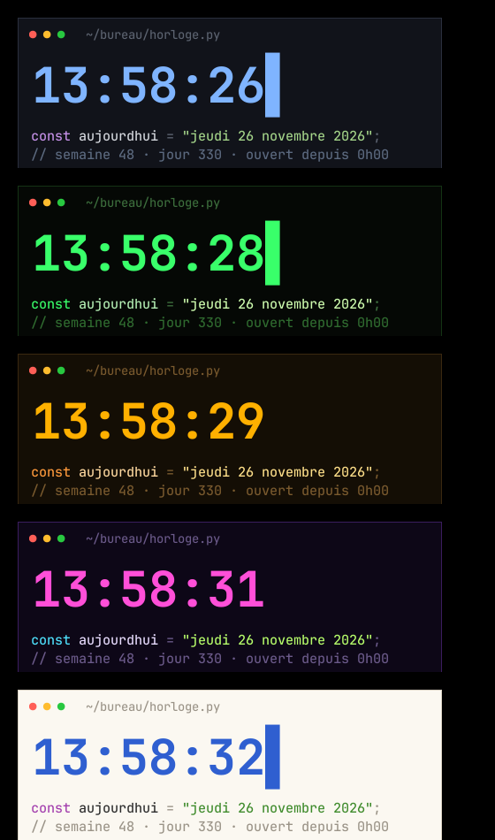
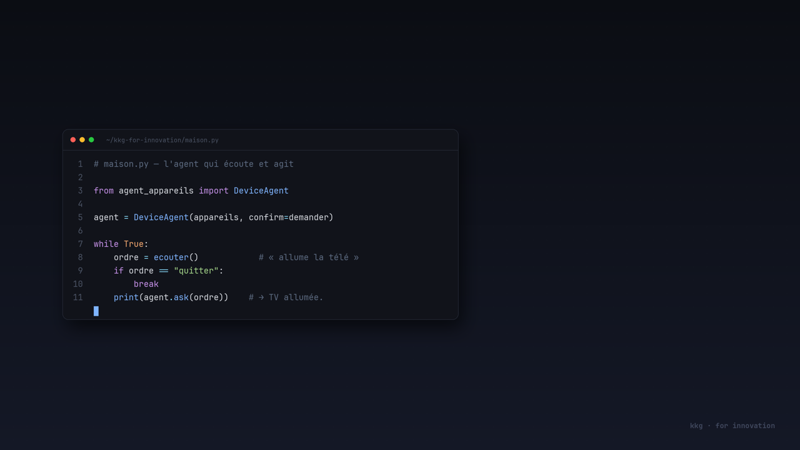

# 🎨 Thème développeur pour votre ordinateur

Un kit qui donne à votre ordinateur un style « développeur » en une commande :

- **Mode sombre** pour le système et les applications.
- **Horloge système** au format 24 h **avec les secondes** (et la date sur Mac et Linux).
- **Fond d'écran « code »** en 4K.
- **Horloge de bureau façon éditeur de code**, qui démarre avec l'ordinateur. Elle propose 5 thèmes :
  Minuit, Terminal, Ambre, Néon et Papier.

## Installation

Téléchargez le projet (bouton vert **Code → Download ZIP** sur GitHub), décompressez-le, puis ouvrez
le dossier `theme_dev`.

Pour l'horloge de bureau, il faut **Python 3** : https://www.python.org/downloads/
(sous Windows, cochez « Add Python to PATH »). Le reste fonctionne sans Python.

| Système | Installer | Tout annuler |
|---|---|---|
| **Windows 10 / 11** | Clic droit sur `installer_windows.ps1` → **Exécuter avec PowerShell** | `powershell -ExecutionPolicy Bypass -File installer_windows.ps1 -Restaurer` |
| **macOS** | Terminal : `bash installer_mac.sh` | `bash installer_mac.sh --restaurer` |
| **Linux (GNOME)** | Terminal : `bash installer_linux.sh` | `bash installer_linux.sh --restaurer` |

- Aucun droit administrateur n'est nécessaire.
- Seul votre compte est modifié.
- Vos anciens réglages sont **sauvegardés** avant tout changement, et la commande « Tout annuler » les remet.

Sous Windows, si un message bloque le script (« l'exécution de scripts est désactivée »), ouvrez PowerShell
dans le dossier et lancez : `powershell -ExecutionPolicy Bypass -File installer_windows.ps1`.
Sur Mac, autorisez le Terminal à contrôler « System Events » si macOS le demande.

## L'horloge de bureau

- **Glisser** pour la déplacer : sa position est retenue.
- **Double-clic** pour passer au thème suivant.
- **Clic droit** pour choisir le thème, le format 12/24 h, afficher ou non les secondes, la garder toujours
  au premier plan, ou la quitter.

Pour la lancer à la main : `python horloge_dev.py` (sous Windows : `pythonw horloge_dev.py`, sans console).
La police **JetBrains Mono** (gratuite : https://www.jetbrains.com/lp/mono/) lui donne le meilleur rendu ;
sinon elle utilise Cascadia, Consolas ou Menlo.

## Bon à savoir

- **Windows 11** : l'affichage des secondes dans la barre des tâches existe depuis la version 22H2
  (mise à jour de fin 2023). Sur une version plus ancienne, le reste du thème s'applique quand même.
- **Windows** : à la fin de l'installation, la barre des tâches disparaît une seconde. C'est normal :
  elle redémarre pour afficher la nouvelle horloge.
- **Linux** : le script vise le bureau GNOME (Ubuntu, Fedora...). Avec KDE, réglez l'horloge par un clic droit
  dessus → *Configurer*. Le fond d'écran et l'horloge de bureau fonctionnent partout.
- Pour régénérer le fond d'écran dans une autre taille : `pip install pillow` puis `python fond_ecran.py 2560 1440`.
